<p align="center">
  
</p>

<p align="center">
  <a href="https://github.com/radiolok/brainfuckpc/actions/workflows/build.yml"></a>
  <a href="LICENCE"></a>
  <a href="https://habr.com/ru/articles/442732/"></a>
  <a href="https://www.youtube.com/playlist?list=PLHI3L7Als_GPlqEA98NgcnIerBVcbE5Fn"></a>
  <a href="https://hackaday.io/project/18599-brainfuck-relay-computer"></a>
  
</p>

<p align="center"><a href="README.md">English</a> · <b>Русский</b></p>

**BrainfuckPC** — 16-разрядный компьютер фон-неймановской архитектуры,
процессор которого собран на **578 советских герконовых реле**. Родной набор
инструкций — Brainfuck, расширенный ровно настолько (`+10` вместо десяти `+`),
чтобы один релейный сумматор делал всю работу. Машина работает на 25 Гц,
печатает *Hello World!* примерно за шесть секунд и, насколько известно автору,
является самым быстрым релейным компьютером — и одним из самых медленно
считающих компьютеров, которые всё-таки досчитывают.

<p align="center">
  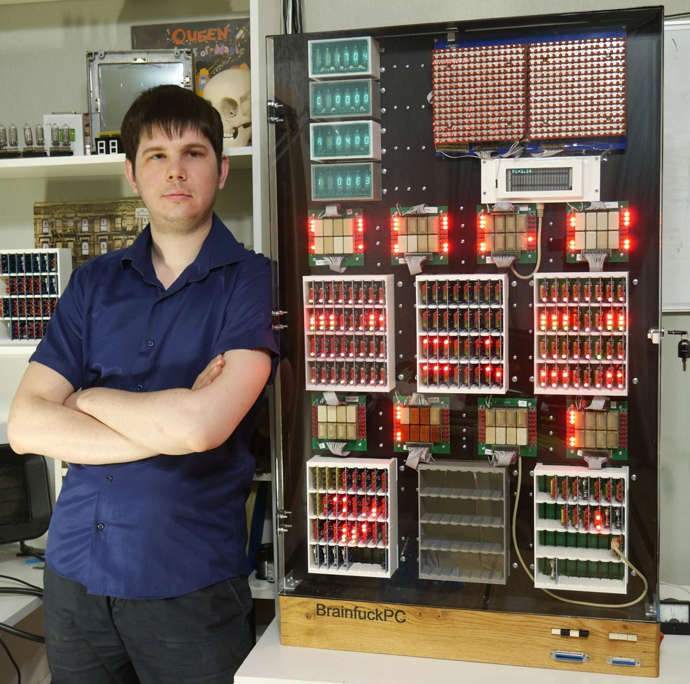
</p>

| | |
|---|---|
| **Архитектура** | фон Нейман, общая память 64К × 16 бит, пословная адресация |
| **Процессор** | 578 герконовых реле (РЭС55 / РЭС64 / РЭС43), 157 логических элементов |
| **Набор инструкций** | [Brainfuck++](doc/instruction_set.md): свёртка `+ - < >`, относительные `JZ`/`JNZ`, `CTRLIO` |
| **Сумматор** | 16 бит, параллельный перенос, ≈ 2 мс на сложение |
| **Тактовая частота** | 25 Гц рабочая, 40 Гц максимум — одна инструкция за такт |
| **Периферия** | плата памяти на SRAM с AVR-загрузчиком, светодиодная матрица 32×16, индикаторы ИВ-6 |
| **Мощность / масса** | 70 Вт · 15 кг |

## Как это работает


Brainfuck нужны только лента, указатель на неё и две скобки цикла. Машина
повторяет это буквально: **указатель инструкций** `IP`, **указатель данных**
`AP` и единственный **16-разрядный сумматор**, на один вход которого подаётся
временный регистр, а на другой — 12-битная константа из инструкции.

Любая инструкция — это «прочитать значение, прибавить константу, записать
обратно»: `IP++` при выборке, затем `*AP += n`, `AP += n` или `IP += n` для
перехода. Сумматору с параллельным переносом нужно всего три задержки реле
вместо 32 у сумматора с последовательным переносом — отсюда и скорость.

Такт состоит из двух фаз: по **спаду** тактового сигнала загружается
следующая инструкция, по **фронту** — исполняется. Подробные временные
диаграммы — в [`waveforms/`](waveforms).


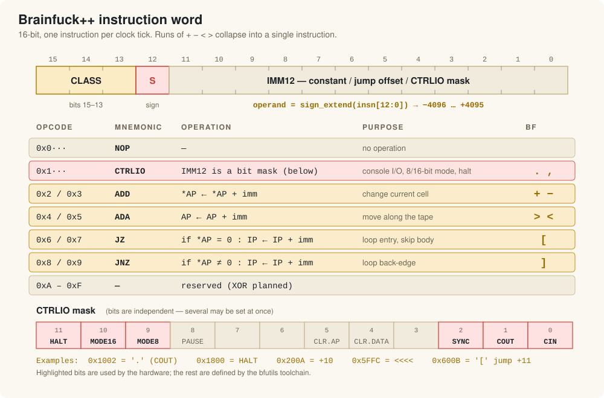

Подробнее (на английском): [архитектура](doc/architecture.md) ·
[набор инструкций](doc/instruction_set.md)

## Железо

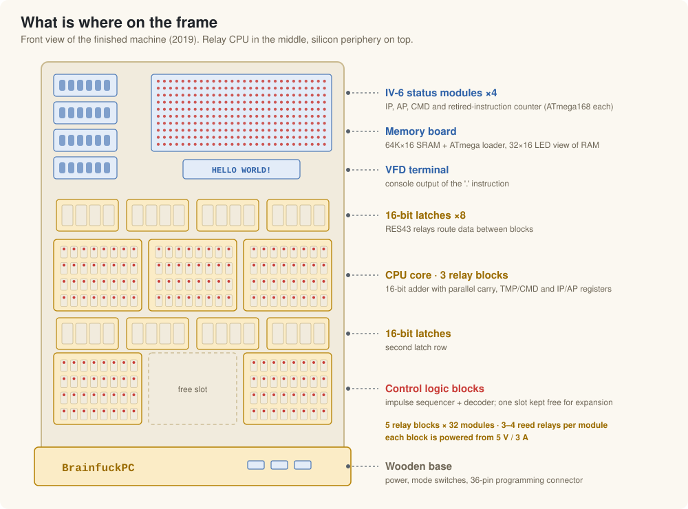

Каждая логическая функция — это маленький сменный **модуль** на 3–4 реле.
32 модуля образуют **блок**, соединения в котором выполнены монтажом накруткой.
Пять блоков, восемь 16-разрядных защёлок, плата памяти и четыре индикаторных
модуля — вот и вся машина.

| | | |
|:---:|:---:|:---:|
| 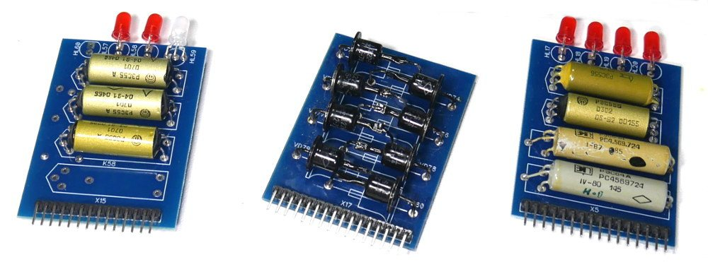 |  | 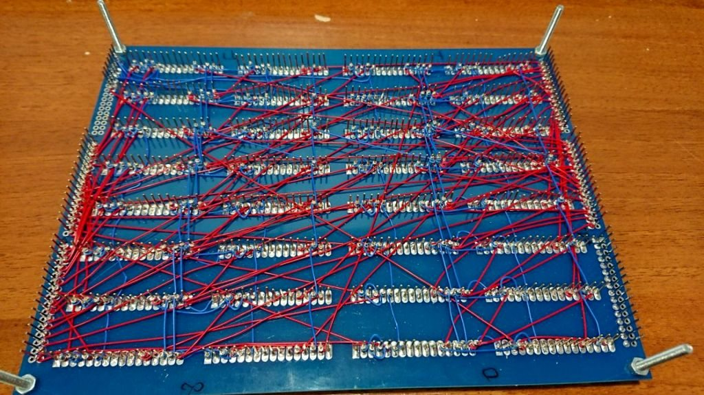 |
| модули D-триггера, диодный, 2AND/2XOR | блок 16-разрядного сумматора — 32 модуля | ~600 выводов на блок, монтаж накруткой |
| 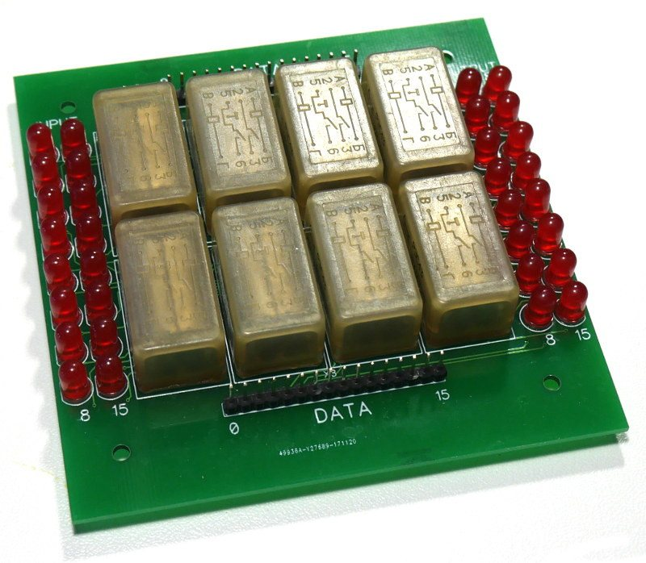 | 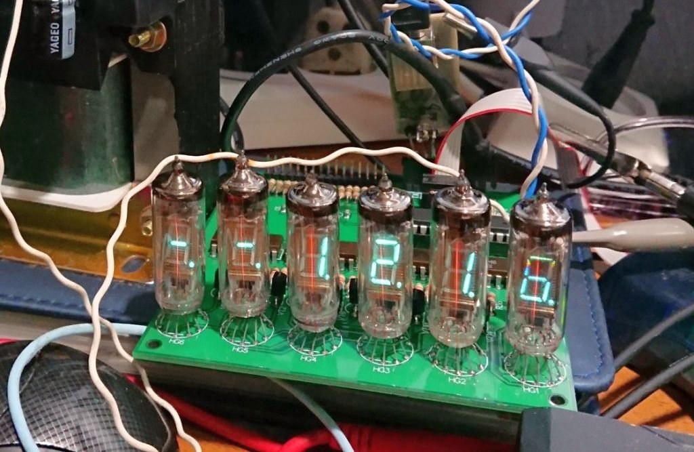 | 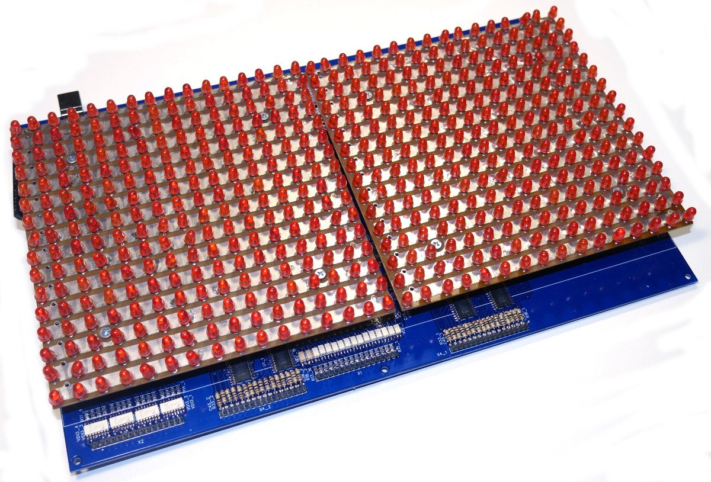 |
| 16-разрядная защёлка на восьми РЭС43 | индикатор регистров на ИВ-6 | плата памяти со светодиодной матрицей |
| 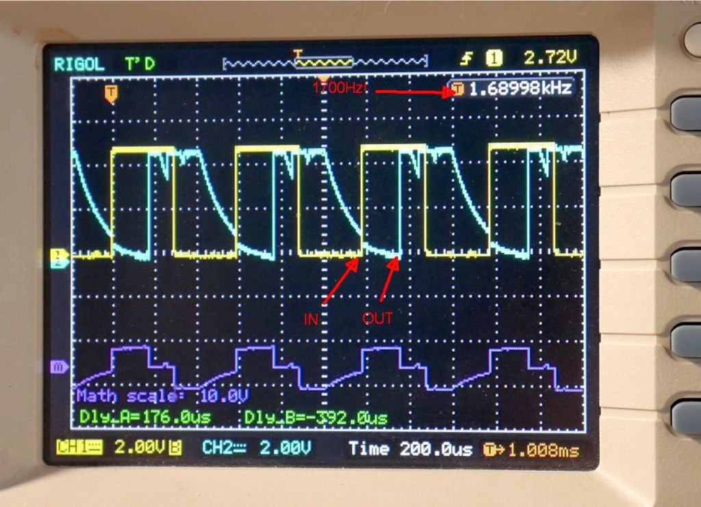 | 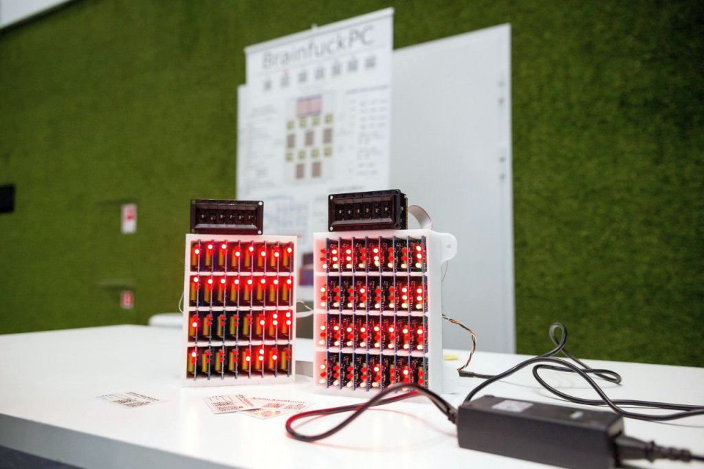 | 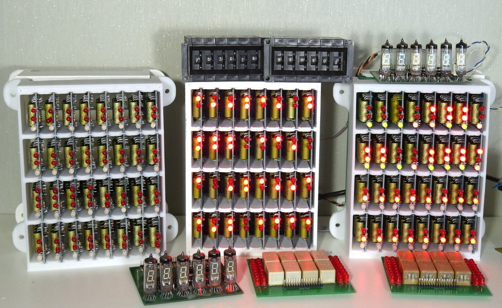 |
| РЭС55 переключается на 1,7 кГц | сумматор и регистры — первый запуск | блоки и индикаторы, 2018 |

Подробнее: [описание железа](doc/hardware.md) — модули, платы и где лежит каждая схема.

## Видео

Вся постройка снята на видео — 34 выпуска от первых набросков в 2017 году до
готовой машины, считающей π:
**[▶ плейлист](https://www.youtube.com/playlist?list=PLHI3L7Als_GPlqEA98NgcnIerBVcbE5Fn)** ·
[список с описанием](doc/videos.md)

| | | |
|:---:|:---:|:---:|
| <a href="https://youtu.be/5hhbGBlP3_4"></a> | <a href="https://youtu.be/CjOYOlJl9wg"></a> | <a href="https://youtu.be/UwRxRw0NNDI"></a> |
| Пожалуй, самый быстрый релейный компьютер в мире | Тройной Brainfuck — доклад на митапе, 2018 | Пи = 4! и другие ошибки вычислений на реле |

## Программы и прошивки

```sh
git clone --recursive https://github.com/radiolok/brainfuckpc
cd brainfuckpc

# компилятор и эмулятор Brainfuck
cmake -S fw/bfutils -B fw/bfutils/build && cmake --build fw/bfutils/build -j
fw/bfutils/bin/bfpp -i bf/examples/hello.b -o hello.bin
fw/bfutils/bin/bfrun -f hello.bin            # Hello World!  Istructions_retired:143

# прошивки AVR для платы памяти и индикаторов
sudo apt install cmake gcc-avr avr-libc binutils-avr
./fw/build.sh                                # → fw/bin/*.hex
```

Каждый push собирается в GitHub Actions; готовые `.hex` прикладываются к
сборке как артефакт `brainfuckpc-firmware`.

Подробнее: [программирование](doc/programming.md) · [прошивки](doc/firmware.md)

## Структура репозитория

```
├── doc/            документация, даташиты, справочные материалы, слайды
├── img/
│   ├── svg/        схемы для документации (+ генераторы в src/)
│   └── habr/       фотографии из статей на Хабре
├── sch/            схемы и платы всех модулей в DipTrace
├── lib/            библиотеки DipTrace: советские реле, посадочные места модулей
├── fw/
│   ├── memorybrd/  прошивка платы памяти (ATmega2560)
│   ├── iv6brd/     прошивка индикаторов ИВ-6 (ATmega168)
│   ├── mcuUtil/    общий планировщик / UART / SPI
│   ├── bfutils/    ⤷ компилятор и эмулятор (сабмодуль)
│   └── build.sh    сборка всех прошивок
├── bf/             программы на Brainfuck и C++-модель для их разработки
├── waveforms/      временные диаграммы всех инструкций (WaveDrom)
├── mech/           механика (DXF / STL)
└── roadmap.md      журнал сборки 2017–2019
```

## Статус

Компьютер **готов на 98%** и исполняет любые программы, не требующие ввода.
Недоделки, оставшиеся при переключении на другие проекты:

- [ ] `CTRLIO.CIN` — ввод с консоли, завязан на логику тактирования (процессор должен останавливаться и ждать данных)
- [ ] логика синхронизации тактов — обвязать три модуля
- [ ] плата памяти rev.2 (только ОЗУ; уберёт залипающий 13-й бит, из-за которого демо идут в 8-разрядном режиме)
- [ ] прошивка программатора и внешний загрузчик
- [ ] печатная машинка Robotron S6130 в роли терминала

## История

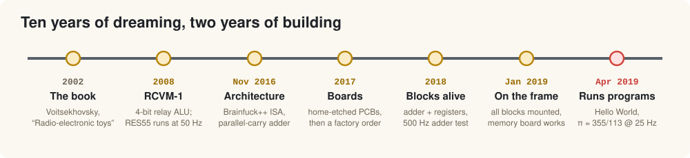

Всё началось с книги Я. Войцеховского «Радиоэлектронные игрушки», где была
описана простая вычислительная машина на телефонных реле. В 2008 году из неё
выросла **РЦВМ-1** — 4-разрядное релейное АЛУ. Десять лет собирания реле
спустя, в ноябре 2016-го, появилась архитектура 16-разрядного BrainfuckPC,
а в 2019 году он исполнил первые программы.

<p align="center">
  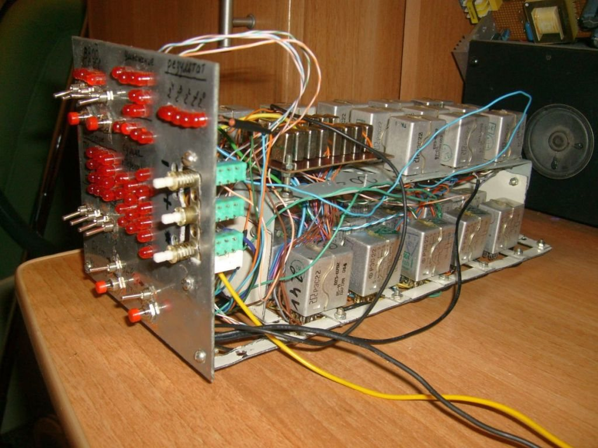
  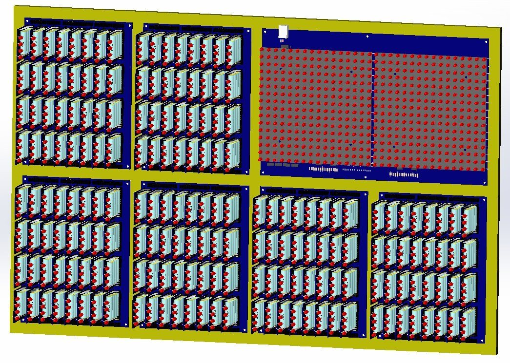
  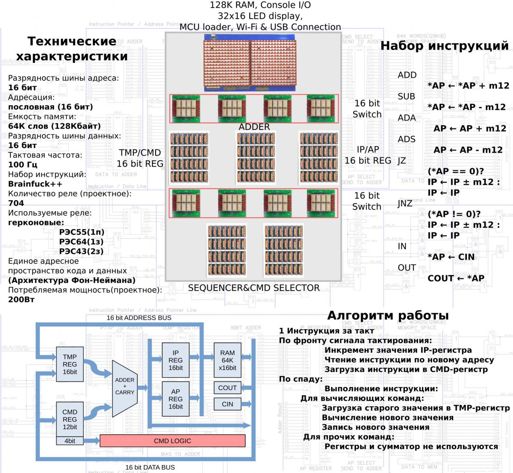
</p>

Полная история с видео — на Хабре:

| Год | Статья |
|---|---|
| 2017 | [Мои маленькие реле: Brainfuck компьютер это магия](https://habr.com/ru/articles/402629/) — проект |
| 2018 | [Мои маленькие реле: Brainfuck компьютер — это реальность](https://habr.com/ru/articles/411145/) — модули, блоки, первые тесты |
| 2019 | [Мои маленькие реле: Тройной Brainfuck, или что такое безумие](https://habr.com/ru/articles/442732/) — готовая машина |

Серия видео: [34 ролика на YouTube](doc/videos.md).
Журнал сборки на английском: [hackaday.io/project/18599](https://hackaday.io/project/18599-brainfuck-relay-computer).

BrainfuckPC стал первым из трёх «невозможных» компьютеров: за ним последовали
струйный (пневматический) компьютер и **DekatronPC** — компьютер на декатронах.

## Лицензия

[GPL-3.0](LICENCE) © Артём Кашканов
