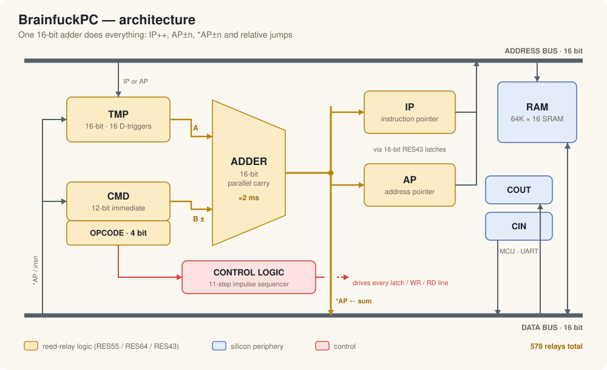
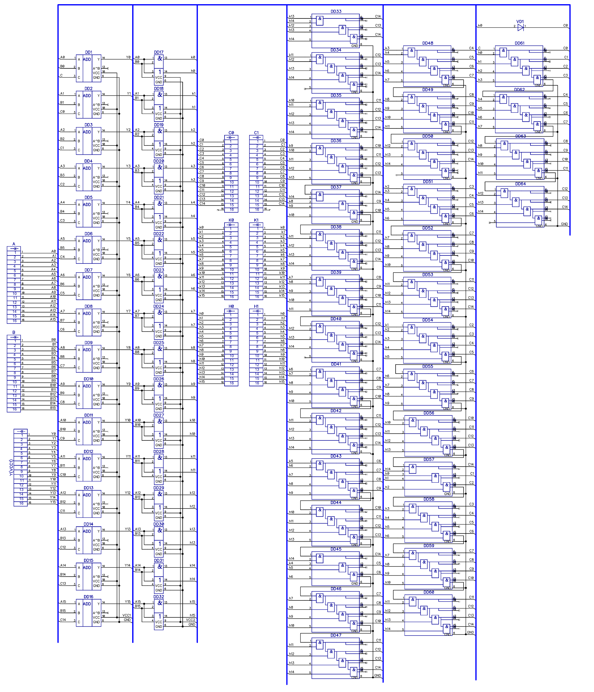
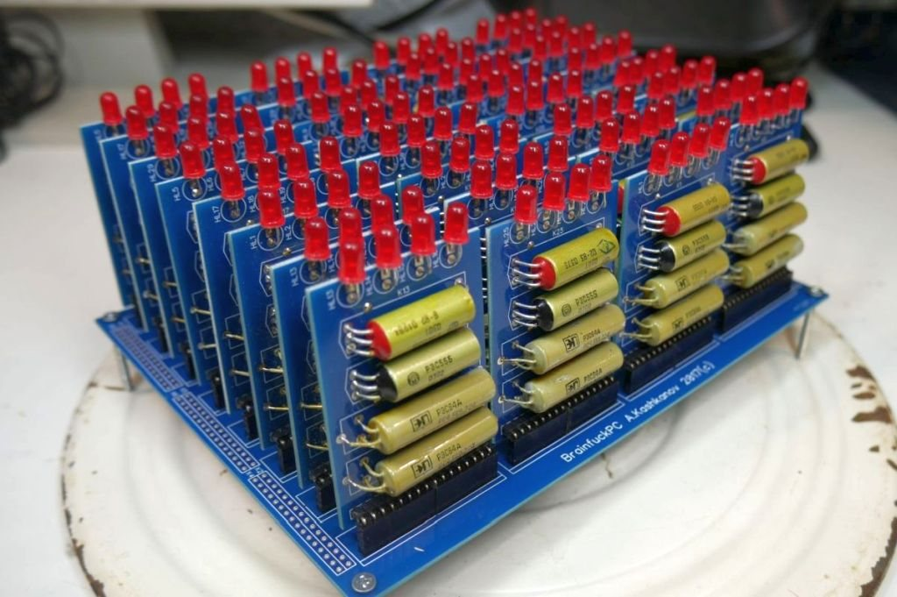
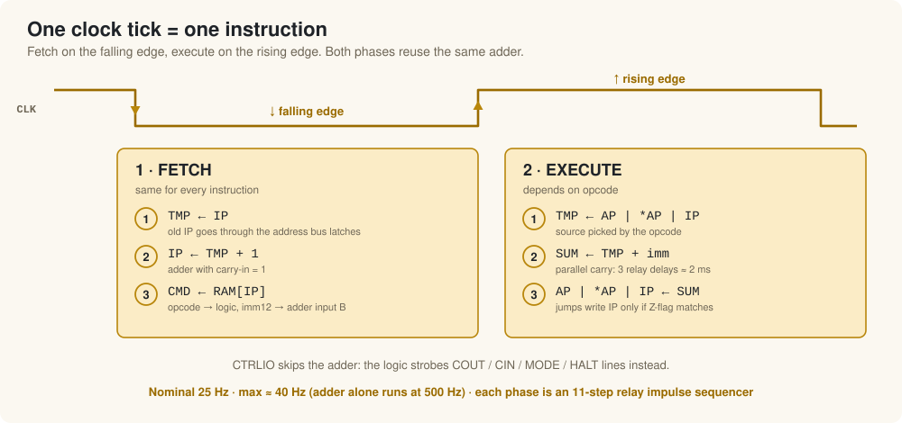

# Architecture

BrainfuckPC is a 16-bit **von Neumann** machine: code and data share one
64K-word address space. The CPU is a direct hardware model of a Brainfuck
"Turing tape" — there are no general-purpose registers, only what the language
needs:

| Register | Width | Role |
|---|---|---|
| `IP` | 16 | instruction pointer |
| `AP` | 16 | address pointer — the current tape cell |
| `TMP` | 16 | adder input A, holds the *old* value being modified |
| `CMD` | 12 + 4 | adder input B (`imm12`, sign-extended to 16 bits) + opcode for the control logic |

All registers are built from relay D-flip-flop modules (64 modules in total).

## One adder for everything

The central element is a **16-bit adder with parallel carry**. Every
instruction is "take a value, add a constant, put it back":

| Operation | Source → TMP | B input | Result goes to |
|---|---|---|---|
| fetch (`IP++`) | `IP` | carry-in = 1 | `IP` |
| `ADD` | `*AP` | `imm` | `*AP` (RAM) |
| `ADA` | `AP` | `imm` | `AP` |
| `JZ` / `JNZ` | `IP` | `imm` | `IP` (only if the zero test matches) |

Because the old value is latched in `TMP` first, the result can be written back
to the very place it came from.

### Carry through contacts

Every relay has a pick-up/drop-out delay — call it one time unit. If each bit
has to wait for the carry relay of the previous bit, a 16-bit add needs up to
**32 units**.

The 2017 design (first Habr article) was a carry-lookahead adder: `2AND/2OR`
generate/propagate terms, chains of `5AND` relay modules, the lower carries
tapped from the full equation for bit 15 — about 130 relays for the carry
alone. In late 2017, after a Geektimes reader suggested it, it was replaced by
a carry chain that runs through relay **contacts**
([#9 @ 2:32](https://youtu.be/CVM_kUdpYJo?t=152),
[#10 @ 3:40](https://youtu.be/ITOvUsOz4D8?t=220)):

* if both bits are 1, the bit's own contacts generate carry-out;
* if at least one bit is 1, a closed contact passes the incoming carry
  straight on to carry-out.

There is no relay coil between carry-in and carry-out, so the carry crosses
all 16 bits without any relay delay. Each sum bit still settles in **3 relay
delays** — about **2 ms** with RES55/RES64 — and the block needs half the
relays of the lookahead version: 32 `2AND/2XOR` modules, two per bit
([#10 @ 7:11](https://youtu.be/ITOvUsOz4D8?t=431)). Freeing a whole block
here is why the logic got a spare slot.

On a test bench the adder alone was clocked at **500 additions per second**.

  
  

## Clock and sequencing

The machine is synchronous: **one instruction per clock tick**.

* **Falling edge — fetch.** `TMP ← IP`, `IP ← TMP + 1`, `CMD ← RAM[IP]`.
* **Rising edge — execute.** `TMP ← source`, `SUM ← TMP + imm`, `dest ← SUM`.
  `CTRLIO` bypasses the adder and only strobes control lines.

Inside each phase an 11-step relay **impulse sequencer** opens and closes the
latches in order. The detailed timing diagrams (WaveDrom sources and PNGs) are
in [`waveforms/`](../waveforms):

| Phase | Diagram |
|---|---|
| Instruction fetch | [`insn_fetch.png`](../waveforms/insn_fetch.png) |
| `ADD` / `SUB` | [`add-sub.png`](../waveforms/add-sub.png) |
| `ADA` / `ADS` | [`ada-ads.png`](../waveforms/ada-ads.png) |
| `JZ` / `JNZ`, taken | [`jz_jnz_taken.png`](../waveforms/jz_jnz_taken.png) |
| `JZ` / `JNZ`, not taken | [`jz_jnz_not_taken.png`](../waveforms/jz_jnz_not_taken.png) |
| Console output | [`cout.png`](../waveforms/cout.png) |

The design target was 100 Hz (that would be four piano octaves of relay
music). In practice the finished machine runs at **25 Hz** and tops out around
**40 Hz**. With an external clock two pulses are needed per tick, so the
synchronisation input accepts up to 80 Hz.

## Control logic

Two of the five blocks hold the control logic. The 2018 estimate was about
50 modules, so the third slot under the data blocks stayed empty
([#20 @ 5:52](https://youtu.be/C9Xb2MUKdUw?t=352)). Before it existed, the
memory-board MCU drove the three data blocks and the latches through 16 spare
outputs, and functions were moved into relays one by one
([#17 @ 3:10](https://youtu.be/8WnqqeKWtjw?t=190)). The parts, as described in
[#25 @ 5:01](https://youtu.be/jh2PmGSnjQA?t=301):

* **Command selector** — an 11-relay decision tree on the four opcode bits.
  The arithmetic classes are merged through diodes into a single `ADDER`
  signal; the sign bit picks add or subtract.
* **Route selector** — connects `TMP`/`CMD` to the adder and decides which
  bus feeds `TMP`. `TMP` has two input latches, one from the address bus and
  one from the data bus, driven in antiphase
  ([#22 @ 1:48](https://youtu.be/R7ZZ5SoqIDg?t=108)).
* **Impulse sequencer** — asynchronous. Many relay computers divide a fast
  clock with a synchronous multi-stage sequencer; here each relay starts the
  next one, so a chain of ~20 relays with ~0.5 ms pick-up each produces a
  10 ms train of shifted pulses
  ([#25 @ 9:13](https://youtu.be/jh2PmGSnjQA?t=553)). The December 2018
  bring-up version had 16 steps; a register write was held for 3 steps and the
  adder got 5. The timing diagrams in [`waveforms/`](../waveforms) were drawn in
  WaveDrom for this ([#27 @ 1:50](https://youtu.be/3DgU2Xs-H1U?t=110),
  [#27 @ 9:40](https://youtu.be/3DgU2Xs-H1U?t=580)).
  Because the timing comes from relay delays, it depends on the supply. In
  2019, copper bus bars added to the sequencer shifted the delays enough to
  break subtraction until the change was reverted
  ([#31 @ 10:25](https://youtu.be/UwRxRw0NNDI?t=625)).
* **Zero detector** — looks at all 16 data lines. An RS trigger on two relays
  stores the 8/16-bit mode and decides whether the high byte takes part; one
  more relay inverts "not zero" into `Z`
  ([#25 @ 9:55](https://youtu.be/jh2PmGSnjQA?t=595)).
* **Console block** — only tells the memory-board MCU to send or fetch a
  character; the UART work is done in silicon
  ([#25 @ 11:19](https://youtu.be/jh2PmGSnjQA?t=679)).
* **Clock block** — in the built machine the next tick starts when the
  sequencer reports that the instruction is done, so the period depends on
  the instruction. A synchronous clock with internal (potentiometer),
  external and MIDI sources was planned
  ([#25 @ 11:52](https://youtu.be/jh2PmGSnjQA?t=712),
  [#19 @ 8:36](https://youtu.be/ZZ1ySaOimjo?t=516)).

## Buses and latches

Data moves over two 16-bit buses. Which register drives the address bus,
which block reads the data bus, and where the adder result goes is selected by
eight **16-bit latch modules**, each made of eight RES43 relays (two contacts
each). Seven of them are needed for the instruction set; the eighth connects
the adder's XOR output to the data bus — the hardware behind the reserved
`XOR` opcode, which never got its control logic
([#22 @ 2:28](https://youtu.be/R7ZZ5SoqIDg?t=148)).

## Memory and periphery

The relay part ends at the bus connectors. Like almost every hobby relay
computer, BrainfuckPC uses silicon around it:

* **RAM** — two 64 KB static RAM chips (cache SRAM from an old Pentium
  motherboard) organised as 64K × 16 words.
* **Memory-board MCU** (ATmega) — loads programs into RAM at power-up, turns
  `COUT`/`CIN` strobes into UART traffic, shows a window of RAM on a 32×16
  LED matrix. During bring-up it also emulated the not-yet-built control logic.
* **IV-6 indicator modules** — show `IP`, `AP`, `CMD` and the retired
  instruction counter.

See [hardware.md](hardware.md) for every board and module.

## Performance

| | |
|---|---|
| Instruction rate | 25 instr/s nominal, ~40 instr/s max |
| Adder latency | ≈ 2 ms (3 relay delays) |
| "FLOPS" | ≈ 16 mFLOPS (as a YouTube commenter computed) |
| Hello World | ~140 instructions ≈ 6 s |
| π ≈ 355/113, 2 digits, 8-bit mode | ~1600 instructions ≈ 1 min |
| π ≈ 355/113, 6 digits | ~60 000 instructions ≈ 40 min |

Not every instruction needs all the sequencer steps. Finishing short ones
early was the plan for reaching 50 Hz
([#28 @ 14:22](https://youtu.be/5hhbGBlP3_4?t=862)).
