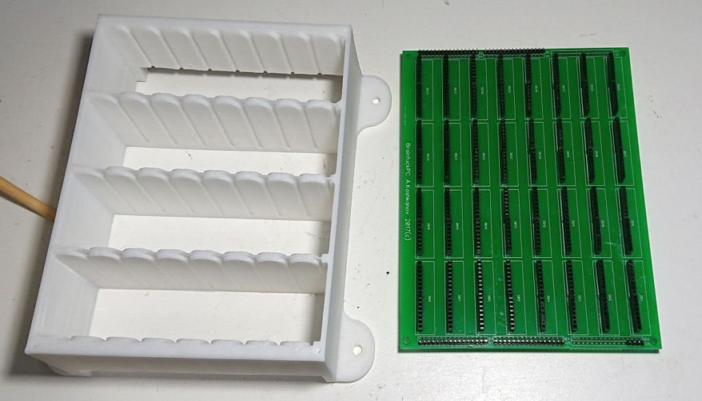
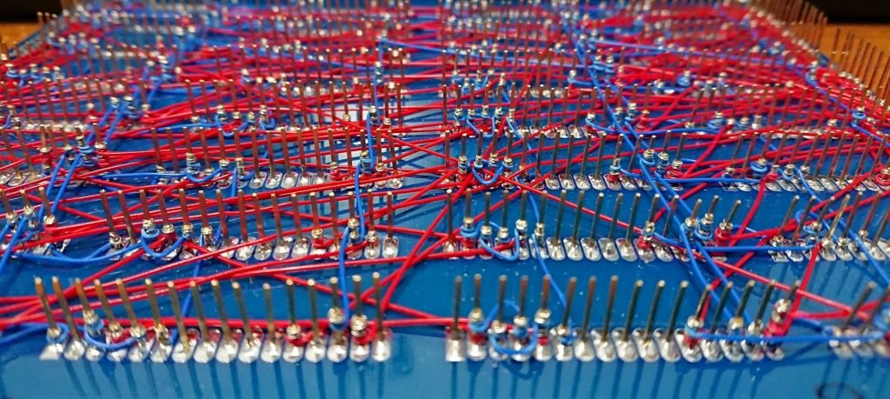
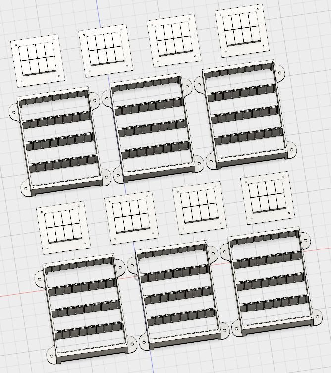
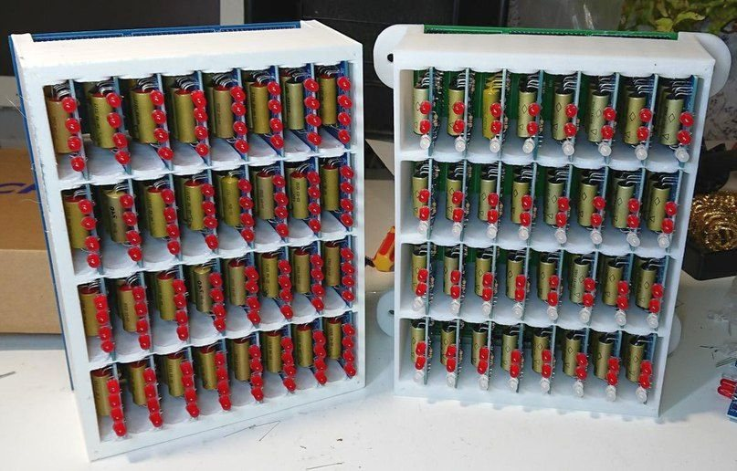

# Hardware

Schematics and PCBs are drawn in **DipTrace** (`.dch` schematic, `.dip` PCB,
version 2.3 or newer). A few structural drawings are in **sPlan 7** (`.spl7`).

## Specifications (2019)

| | |
|---|---|
| Relays | 578 (RES55, RES64 reed relays; RES43 in latches) |
| Logic elements | 157 |
| Address bus | 16 bit, word addressing |
| Data bus | 16 bit, 8-bit compatibility mode |
| RAM | 64K words × 16 bit (128 KB) |
| Clock | 25 Hz nominal, 40 Hz max, 1 instruction / tick |
| Power | 70 W, 5 V / 3 A per relay block |
| Size | 1100 × 650 × 140 mm (approx.) |
| Weight | 15 kg |

## Hierarchy: relay → module → block → frame

### Relays

Soviet reed relays: **RES55** (1 changeover contact) and **RES64** (1 make
contact) in the logic, **RES43** (two make contacts) in the bus latches. A
RES55 driven through a transistor stage switches cleanly at **1.7 kHz** on the
bench — ordinary telephone relays give up at about 20 Hz.

Where the relays came from:

* The first batch of about 800 reed relays was bought in 2010
  ([#3 @ 0:21](https://youtu.be/Vkg3DC9bF2k?t=21)).
* Relay boards from B5 laboratory power supplies (21 RES55 each), bought at a
  radio market for 50 rubles a board, added about 80 five-volt RES55
  ([#4 @ 6:27](https://youtu.be/eaObw0Ac1S0?t=387)).
* In 2017, roughly 250 RES55 turned out to be 12-volt parts (passport 06).
  They do pull in at 5 V, but slowly, which left the build about 100 relays
  short ([#11 @ 1:03](https://youtu.be/qt5j-cp09JQ?t=63)).
* At the end of 2017, 200 new 6-volt RES55 were bought, giving a reserve of
  over 400 relays ([#12 @ 12:21](https://youtu.be/iSUq5iGlJQY?t=741)).

### Modules

Every logic function lives on a small plug-in module: a 40 × 64 mm PCB with up
to 4 relays, up to 4 status LEDs and a 16-pin connector (some use 12 or 14).

| Module | Schematic | Function | Used in |
|---|---|---|---|
| 2AND / 2XOR | [`sch/2AND_2XOR_module`](../sch/2AND_2XOR_module) | half-adder pair | adder block, 32 pcs (2 per bit) |
| D-trigger | [`sch/REG_module`](../sch/REG_module) | 1-bit register, Q and ~Q out | register blocks, 64 pcs |
| 2AND / 2OR | [`sch/2AND_2OR_module`](../sch/2AND_2OR_module) | universal: 4AND, 4OR, 4AND-NOT… | control logic |
| 2AND ×4 SW | [`sch/2ANDx4_SW_module`](../sch/2ANDx4_SW_module) | four relays on make contacts | latches, control logic |
| Diode | [`sch/Diode_module`](../sch/Diode_module) | 8 × D226 diodes, wired-OR with zero delay | carry chain, logic |
| Switch | [`sch/switch_module`](../sch/switch_module) | switch board (PCB layout only) | — |
| Relay driver | [`sch/Driver_module`](../sch/Driver_module) | transistor / MOSFET relay drivers (variants) | clock, I/O |

   
  Left to right: D-trigger, diode module, 2AND/2XOR

The module PCBs were ordered from China as panels of 6 × 4 modules, milled so
that they snap apart. Ten panels of each kind made 240 module blanks, for
about $150 including shipping ([#10 @ 1:17](https://youtu.be/ITOvUsOz4D8?t=77)).

**D-trigger, inside.** The storage relay holds itself on through its own make
contact in series with a break contact of the reset relay. A steering relay
sends the write pulse to *set* or to *reset* depending on the data input, and
a diode keeps the output from feeding back into the input. The latch is level
sensitive, not edge triggered: while the write pulse is held, Q and ~Q can both
read 0. The fourth relay (enable) is left off in 60 of the 64 register
modules; the bus latches do that job instead
([#14 @ 9:51](https://youtu.be/Skp5epUs-tM?t=591)). One module draws 136 mA,
mostly in its LEDs ([#14 @ 17:05](https://youtu.be/Skp5epUs-tM?t=1025)),
which is why later modules got only two LEDs
([#16 @ 8:37](https://youtu.be/zqWaLdvAkPY?t=517)).

**Tester.** Every module was checked before it went into a block, on a small
bench board: a module socket, 8 buttons, 4 LEDs on the outputs, and a 2 × 20
header that takes a soldered jumper card for each module type. One card per
type, then all 32 adder modules or all 64 triggers go through in a row
([#9 @ 0:26](https://youtu.be/CVM_kUdpYJo?t=26)).

### Blocks

32 modules (8 × 4) plug into a **base board** — 200 × 150 mm, no copper
traces, just 32 sockets with long square pins for **wire-wrap**. Around 600
pins per board are wrapped by hand. A 3D-printed basket (PLA / HIPS) holds the
modules so they survive transport.

| Block | Contents |
|---|---|
| Adder | 16-bit adder, sum and XOR outputs, carry-in line |
| IP / AP registers | two 16-bit registers |
| TMP / CMD registers | 16-bit TMP, 12-bit CMD, 4-bit opcode register with enable |
| Control logic ×2 | impulse sequencer and instruction decoder; a third slot is left free |

Base board: [`sch/Base_board`](../sch/Base_board). On the first batch the
holes were too tight because the plating thickness was not allowed for, and
every pin had to be forced in after widening the hole with an awl. The second
revision fixed the drill size ([#14 @ 3:57](https://youtu.be/Skp5epUs-tM?t=237)).

**Wire-wrap.** AWG30 wire with a WSU-30 tool, about 2–2.5 cm stripped per end.
The insulation is pushed into the tool so that the first turns on the post are
insulated. Point-to-point lines go first; the common lines (power, ground,
write strobes) are added across them afterwards and hold them taut. A register
board has about 150 jumpers and takes 3–4 hours. Each group got its own power
and ground wire, because the thin wire is not enough for the current of a
whole block ([#15 @ 0:30](https://youtu.be/ctT1eXD5qDE?t=30),
[#15 @ 11:47](https://youtu.be/ctT1eXD5qDE?t=707)).

**Power.** The blocks take +5 V from a 1 mm copper wire run on 3D-printed
standoffs; ground goes through the aluminium frame
([#22 @ 0:08](https://youtu.be/R7ZZ5SoqIDg?t=8)). At first the carry-in line of
the adder was fed from the neighbouring block through half a metre of thin
wire, and at the top MIDI frequencies the adder missed carries. The fix was
0.25 × 10 mm copper strips to every module, under 15 mΩ corner to corner,
with the frame as the ground return ([#25 @ 0:45](https://youtu.be/jh2PmGSnjQA?t=45),
[#25 @ 1:39](https://youtu.be/jh2PmGSnjQA?t=99)). At the first power-up the
machine drew 4.3 A at 5 V, about 3 A of it just to hold four registers
([#23 @ 8:20](https://youtu.be/OsPinBNLMro?t=500)).

**Cables.** The blocks and latches are joined with 20-wire ribbon cable (16-wire
was hard to buy); about 10 m went in. Every cable was cut in place and
numbered, with small splitter boards where one output feeds two or three inputs
([#22 @ 1:06](https://youtu.be/R7ZZ5SoqIDg?t=66),
[#23 @ 3:58](https://youtu.be/OsPinBNLMro?t=238)). In hindsight, IDC connectors
crimped onto the flat cable would have saved crimping each wire by hand
([#25 @ 0:11](https://youtu.be/jh2PmGSnjQA?t=11)).

  
  

### Latches

Eight 100 × 100 mm boards, each with eight RES43 relays and LEDs showing the
input and output state, route 16-bit words between blocks.

### Frame

A laser-cut, welded and painted 2 mm aluminium frame carries everything; it sits
on a wooden base with switches and connectors. Chassis CAD files are under
[`doc/Chassis`](Chassis) (not all of them are in git — see `.gitignore`).

The frame was drawn for 6 mm aluminium plates joined with screws
([#19 @ 4:08](https://youtu.be/ZZ1ySaOimjo?t=248)). 6 mm was too heavy and too
expensive, so it was made from 2 mm, which meant welding instead of screws.
Welding turned out to be a poor choice; next time the plan is bent tabs and
rivets ([#20 @ 4:09](https://youtu.be/C9Xb2MUKdUw?t=249)). The colour, black,
was chosen by a vote of subscribers. The thin frame flexes, so a 6 mm acrylic
back panel on standoffs was added to stiffen it
([#26 @ 2:08](https://youtu.be/MGb6U_M67Wg?t=128)), and a weld that cracked
was reinforced with angle pieces and rivets
([#28 @ 13:51](https://youtu.be/5hhbGBlP3_4?t=831)).

The oak stand ([#32 @ 4:53](https://youtu.be/BjQQjhtGF4E?t=293)) holds:

* a 5 V / 70 A power supply, switched on by a relay;
* a 30 A ammeter on a shunt;
* the programming connector;
* a 25-pin LPT-style connector meant for a printer.

A programmer board for the connector was built but never got firmware.

  
  

## Silicon periphery

### Memory board — [`sch/MemoryBrd`](../sch/MemoryBrd)

* Two 64 KB static RAM chips (UM61512AK-15, datasheet in [`doc/`](um61512ak-15.pdf)) → 64K × 16.
* Address and data buffers with protection, connected to the relay buses.
* `W/R` and `Sync` lines from the relay logic start a memory cycle.
* ATmega MCU (firmware: [`fw/memorybrd`](../fw/memorybrd)) for program loading,
  console UART and the LED view.
* 32 × 16 LED matrix (two 16 × 16 panels, TLC5941 / STP16 drivers) showing a
  region of RAM in real time.
* **rev.2** (`memoryBrd_rev2.dip`, `memory_rev2.dch`) keeps only the RAM and
  bus interface — the rev.1 board has a fault that sets bit 13, which forced the
  2019 demos into 8-bit mode. Address and data lines of rev.2 are routed.
* On rev.1 the column-select chips of the LED matrix were routed so that they
  blocked pins the MCU needed. One panel was rebuilt to load over a serial
  interface ([#28 @ 2:51](https://youtu.be/5hhbGBlP3_4?t=171)).
* In 2019 the UART console was joined by a 20 × 4 vacuum-fluorescent text
  display, mounted under the memory board
  ([#31 @ 1:41](https://youtu.be/UwRxRw0NNDI?t=101)).

### IV-6 indicator module — [`sch/IV6_module`](../sch/IV6_module)

100 × 100 mm board with six IV-6 VFD tubes, K155TM8 latches and an ATmega168.
It has a 16-bit parallel input for reading a register directly plus a UART.
Four of them show `IP`, `AP`, `CMD` and the retired instruction counter.
Firmware: [`fw/iv6brd`](../fw/iv6brd).

Details from [#13 @ 2:47](https://youtu.be/epKDDrXUENw?t=167):

* The segments are driven through 2N2222 transistors.
* The 16-bit input is a pair of '165 shift registers on the SPI pins. That
  clashes with ISP programming, so those traces were cut, and the boards are
  flashed through a UART bootloader instead.
* The boards are meant to be chained in a UART ring: a packet that is not for
  this board is passed on. Eight hops still allow about 50 updates per second.

The tubes need two more supplies, 48 V for the anodes and 1 V for the
filaments, about 1 A each ([#23 @ 0:34](https://youtu.be/OsPinBNLMro?t=34)).
How to read the four indicators:

* bottom — `IP`;
* `A` — `AP`;
* `C` — the instruction. A zero high octet means a fetch is in progress;
  anything else means the instruction is executing;
* top — the retired-instruction counter, which tells how long until the next
  output ([#31 @ 0:56](https://youtu.be/UwRxRw0NNDI?t=56)).

### Relay drivers

The plan was to drive control lines from the memory board through TLP281
optocouplers. A transistor stage like that drops about 2 V and gives 150 mA,
which is not enough to pull in even one relay, so the outputs were redone as
P-MOSFET high-side switches with an NPN transistor pulling the gate down
([#25 @ 3:00](https://youtu.be/jh2PmGSnjQA?t=180)). For the latches and
register writes there are also 6-channel driver boards with 1 A DIP reed
relays ([#26 @ 4:52](https://youtu.be/MGb6U_M67Wg?t=292)).

### Programming connector

A 36-pin connector exposes 16 address lines, 16 data lines, power, ground and
read/write strobes, so any loader can fill the RAM: the on-board MCU, an
external programmer ([`sch/programmator`](../sch/programmator)), a toggle-switch
panel or a punched-tape reader ([`sch/Reader`](../sch/Reader)). The pinout is
meant to be LPT-compatible.

### Other boards

| Folder | What |
|---|---|
| [`sch/rs-232_output`](../sch/rs-232_output) | RS-232 console output |
| [`sch/[DEPRECATED]`](../sch/%5BDEPRECATED%5D) | earlier designs: ripple-carry `ADD+C`, `5AND`, big base board, PDP-11 style register module… |
| [`lib/`](../lib) | DipTrace libraries for Soviet relays and the module footprints |

## Terminal

A Robotron S6130 daisy-wheel typewriter was acquired to become a real
teletype-style terminal. Its controller board was damaged by leaking NiCd
cells, so this part is still a dream.

## Ideas that were not built

* **Tape reader in the empty slot.** The sixth block position could hold a
  punched-tape reader, so that a program loads from tape at the press of a
  button without an external programmer
  ([#34 @ 11:20](https://youtu.be/kuoVp4o0ClQ?t=680)).
* **Inductive "punched plate" reader.** Two of these Soviet devices were
  bought at an auction: a 14 × 32 matrix of coils, each with two windings. A
  plate with or without a shorted copper ring over each coil would encode
  56 bytes. The machine has no input path for it, so it was put aside for the
  tube computer ([#21 @ 1:14](https://youtu.be/HTYh7WxUHuo?t=74)).

## Reference library

[`doc/`](.) also holds datasheets and historic material collected along the
way: Z80 and U880 manuals, the Harwell WITCH computer documentation, HP 2100A
booklets, ferrite core memory notes, the Robotron S6130 manual and schematics.
